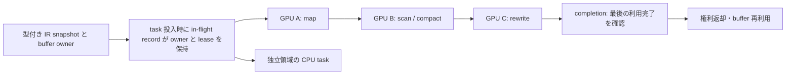

# Metal 向け コンパイラ と 実行基盤

Metal を前提にコンパイラ自身を高速化するなら、最初の候補は、**型付きの配列 IR を CPU/GPU で共有し、幅のある連続した処理領域だけを GPU に常駐させる構成**である。Bend からは共通 core と所有権、Mojo からは共通計算本体と特殊化、MLX/MAX からは配列・依存追跡・融合を借りられる。一方、affine 性だけでは負荷均衡や非同期バッファの寿命、最適な配置は決まらない。小さい意味パスを保ちつつ、物理カーネルは合法な範囲でまとめ、配置は入力サイズに加えて並列幅・依存深さ・キュー待ち・中間メモリを使って判断する、というのが本稿の設計提案である。GPU 上の名前解決や限定的な型検査には先行実績があるが、一般の依存型チェッカや小さい LSP 編集に対する優位性は未確認である。したがって、まず強い CPU 実装を作り、同一の意味を持つ数種類のパスで GPU 常駐と自動配置を反証可能に比較するのがよい。

調査基準日は **2026-11-15**。Bend はローカル HEAD `f0cf0a7c573145501981c44d9c33e326185f008e`、Mojo は **1.2.0**、MAX は **26.7**、MLX の実装確認は **0.32.4**を対象とする。([Bend の対象 commit](https://github.com/bendlang/bend/commit/f0cf0a7c573145501981c44d9c33e326185f008e)、[Mojo releases](https://mojolang.org/releases/)、[MAX 26.7](https://max.modular.com/releases/v26.7/)、[MLX 0.32.4](https://github.com/ml-explore/mlx/releases/tag/v0.32.4))

## Bend と Mojo の共通化と配置判断

### Bend の現行設計は所有する task と明示的 continuation を使う

現行 Bend は、古い HVM の interaction-net reduction engine をそのまま発展させたものではない。affine な値の所有権を使い、呼び出しを tail・cut・fork に整理し、continuation と task を明示した flat evaluator を CPU と GPU に展開する。CPU 側は tail call、device 側は segment を選ぶ switch と value stack を使う。ここで共通化されるのは評価の意味と主要な runtime コードである。`comp.ts` 自身は TypeScript のデータ構造を走査して C/JavaScript を生成するホストプログラムなので、**GPU を対象とするコンパイラであることと、コンパイラ自身が GPU で走ることは別**である。([BendRT の設計変更](https://github.com/bendlang/bend/blob/f0cf0a7c573145501981c44d9c33e326185f008e/bend2/docs/BendRT/main.typ#L579-L587)、[呼び出しと continuation](https://github.com/bendlang/bend/blob/f0cf0a7c573145501981c44d9c33e326185f008e/bend2/docs/BendRT/main.typ#L197-L217)、[compiler の入力と出力](https://github.com/bendlang/bend/blob/f0cf0a7c573145501981c44d9c33e326185f008e/bend2/comp.ts#L2784-L2818))

この共通化は、同じプログラムを異なる装置へ送る土台として魅力がある。ただし、affine は高々一回の使用であり、必ず一回使う linear 性とは違う。共有可能なデータには参照カウント等が残り、通常の配列を木として分割・再構成する場合にはコピーも生じる。corpus は添字で参照する flat な領域だが、すべてのフィールドが SoA という意味でもない。コンパイラ IR に連続した tag/operand 列を導入する案は、Bend の「flat」をそのまま採用する以上のレイアウト設計になる。([BendTT の binder と型](https://github.com/bendlang/bend/blob/f0cf0a7c573145501981c44d9c33e326185f008e/bend2/docs/BendTT/main.typ#L277-L300)、[BendRT の ownership と配列](https://github.com/bendlang/bend/blob/f0cf0a7c573145501981c44d9c33e326185f008e/bend2/docs/BendRT/main.typ#L303-L341))

Bend の parallel let は、独立した処理をおおむね等時間に分ける契約を持つ。pure/affine 性は独立性を支えるが、等 work の分割はプログラマの責任として残る。現行 scheduler は固定の ring cube を波ごとに処理し、stealing や rebalance を行わない。よって、所有権が明瞭だから不規則なコンパイラ処理も自然に均衡する、とは言えない。深い正規化、偏った symbol lookup、少数の重い定義を持つ入力では、幅と work の偏りを別々に測る必要がある。([GUIDE の parallel let](https://github.com/bendlang/bend/blob/f0cf0a7c573145501981c44d9c33e326185f008e/guide/GUIDE.md#L147-L157)、[BendRT の scheduler](https://github.com/bendlang/bend/blob/f0cf0a7c573145501981c44d9c33e326185f008e/bend2/docs/BendRT/main.typ#L409-L475))

現在の `f!(x)` も、任意の非同期 future ではない。逐次評価から GPU 側へ計算を渡し、完了後に continuation へ戻す境界であり、ユーザーの CPU 計算と GPU 計算は同時に進まない。一方でホストは GPU 実行中に後続 command buffer を投入でき、Metal backend は複数 round を event chain で先行投入する。**ユーザー計算の排他的な実行と、ホストの command submission の重なりは両立する。** 入力量や実測値に基づく CPU/GPU 選択器は、この dispatch 経路にはない。([Bend の offload 経路](https://github.com/bendlang/bend/blob/f0cf0a7c573145501981c44d9c33e326185f008e/bend2/comp.ts#L5304-L5337)、[Metal の先行投入](https://github.com/bendlang/bend/blob/f0cf0a7c573145501981c44d9c33e326185f008e/bend2/comp.ts#L4960-L4998))

### Mojo MAX MLX の生成と融合と依存追跡

Mojo/MAX は調査時点で Apple M1–M5 を対象に GPU コードを生成でき、Metal 4 向けターゲットも公開している。Mojo では共通の計算本体を CPU/GPU に特殊化し、必要な箇所はターゲット別実装に分けられる。ただし MAX の Apple GPU によるモデル実行は開発中という位置づけで、他の主要 GPU と同じ検証範囲があるとはされていない。共通ソースから最適なレイアウトや粒度まで自動で得られる、と期待する段階ではない。([GPU 互換表](https://max.modular.com/gpu/hardware-compatibility/)、[custom op の CPU/GPU 特殊化](https://max.modular.com/develop/build-custom-ops/)、[MAX の要件](https://max.modular.com/system-requirements/))

MAX は単なる起動ラッパーではなく、複数段の lowering、fusion、メモリ計画、非同期 dispatch を持つ。公開 custom-op API の静的な `elementwise()` は周囲の演算と融合できるが、一般の `execute()` は独立した kernel になる。不規則な IR pass を opaque な custom op に包むだけで、内部の走査や副作用まで理解した融合は得られない。Mojo の MLIR 採用や inline MLIR もコード生成の機構であり、その compiler pass 自身が GPU で実行される証拠ではない。([MAX の compiler 構造を説明した2025年発表](https://llvm.org/devmtg/2025-10/slides/technical_talks/boulala.pdf)、[現行 custom-op 契約](https://max.modular.com/develop/build-custom-ops/)、[Mojo inline MLIR](https://mojolang.org/docs/reference/inline-mlir/))

ここには二種類の IR がある。本稿の AST/SSA を配列化した IR は、CPU/GPU pass が読み書きする**入力データ**である。Mojo の MLIR や MAX の graph IR は、その pass の計算を記述し、kernel を生成・最適化する**計算表現**である。後者が高度でも、前者の不規則な変換から独立作業を発見し、適切な並列アルゴリズムに変える設計までは自動的に得られない。「Mojo が既に最適化するか」という問いは、生成コードの最適化と、compiler workload の分解・配置を分けると判断しやすい。

MLX は unified memory 上の array、lazy graph、CPU/GPU stream 間の依存挿入、`mx.compile` による融合と cache を既に備える。ただし 0.32.4 の default device は GPU の可用性で選ばれ、演算ごとの CPU/GPU 配置は利用者の stream 指定に従う。公式の「小さい演算を CPU、大きい演算を GPU」の例も、利用者が配置する例である。MAX にも tensor mesh の再配置を採点する cost model や GPU 内 scheduling のモデル、特定推論処理の online 適応はあるが、これらは一般の compiler-pass DAG を実測から CPU/GPU に配る scheduler と同一ではない。今回の公開資料では後者の汎用機能を確認できなかった。([MLX unified memory](https://ml-explore.github.io/mlx/build/html/usage/unified_memory.html)、[0.32.4 の default device](https://github.com/ml-explore/mlx/blob/v0.32.4/mlx/device.cpp#L11)、[MLX compilation](https://ml-explore.github.io/mlx/build/html/usage/compile.html)、[MAX sharding](https://max.modular.com/api/python/experimental.sharding/)、[GPU TargetCostModel](https://max.modular.com/api/mojo/pipeline/types/TargetCostModel/))

## 配列コンパイラの先行例は幅を作れることを示す

Co-dfns の中核変換は、木を parent/sibling 等の添字配列として扱い、構築済み AST の低位化と名前解決を配列操作に置き換える。Hsu の博士論文で比較された GPU 版は、この部分を C++/ArrayFire CUDA に手作業で翻訳したものだった。本人の後年の説明によれば、自動翻訳までを学位研究で実装したわけではない。**「17行の変換」と、字句解析からコード生成までを備えた製品コンパイラ全体の GPU self-host は分けるべきである。**([Hsu 博士論文](https://scholarworks.iu.edu/dspace/bitstreams/dcbd5240-8454-4533-bc0c-ac3ee7628b8e/download)、[本人による ArrayCast の説明、14:03以降](https://www.arraycast.com/2025/03/01/The-100th-Episode-with-Aaron-Hsu.html))

測定条件も重要である。論文は Xeon E5-2623v3 と GTX 980 を用い、1,019 ノード、lexical depth 3、tree depth 15 の AST を複製して幅を増やした。同じパス構成の Nanopass と比較し、GPU の主要時間には転送前後を含めず、転送は別に報告している。この結果は大量の浅い独立作業を GPU へ変換できる根拠になるが、深い依存鎖、最新の CPU データ指向実装、Metal の end-to-end latency に対する期待倍率には使えない。([Hsu 論文 pp.144–150](https://scholarworks.iu.edu/dspace/bitstreams/dcbd5240-8454-4533-bc0c-ac3ee7628b8e/download))

Pareas はさらに、Futhark で字句解析・構文解析・意味解析を GPU 実行した直接例である。ただし言語の型は少数の基底型と参照で、型変化を結合的な集約に落とせる設計だった。依存型の定義的等価判定や、共有メタ変数を更新する一意化全体への一般化は未解決である。著者は、GPU 向けに全木走査を繰り返す構成、適切な CPU baseline の不足、一時メモリ、小入力の同期費用を限定として挙げている。主要な GPU グラフとは別に、初期化平均4.6秒も報告される。これらは「GPU コンパイラは不可能」という材料ではなく、アルゴリズムと測定境界を揃える必要性を示す。([Pareas 論文 §4–6](https://theses.liacs.nl/pdf/2020-2021-VoetterRobin.pdf)、[実装](https://github.com/Snektron/pareas))

この二例から採るべき判断は、名前や型に状態があるだけで GPU 対象から外さず、どこに幅を作れるかを明示することだ。独立 scope の名前解決、制約生成、局所チェック、正規化要求の batch は候補になる。一方、次の制約が直前の解に依存する鎖は、同じ総ノード数でも並列性が小さい。配列化は木の意味を消さず、構造・scope・source span を列と添字で表す。その際、「どのノード順序の配列か」を混ぜる危険は所有権だけでは防げない。BQN 実装者の比較は、診断位置の保持が可能なことと、配列軸の整合性が保守上の難所になることを具体的に示している。([BQN 実装者による Co-dfns 比較](https://mlochbaum.github.io/BQN/implementation/codfns.html))

関連する設計要素は、一つの既存処理系からまとめて得るより、役割ごとに選ぶ方が明確になる。

| 参照先 | 既にある仕組み | 今回使う範囲と限界 |
|---|---|---|
| Nanopass | 中間言語と小さい変換の契約 | 意味パスの分割に使う。GPU の粒度や並列性は別設計。([公式ガイド](https://docs.racket-lang.org/nanopass/index.html)) |
| StarPU | 複数実装の codelet、依存 DAG、履歴による時間モデルと online calibration | 配置器の直接の先例。native Metal 対応は公式一覧で未確認。([公式 Features](https://starpu.gitlabpages.inria.fr/features.html)) |
| Futhark | 複数の並列実装と閾値選択、flattening、融合 | 並列幅に応じた実装選択を借りる。一般の online CPU/GPU 配置とは異なる。([PPoPP 2019](https://futhark-lang.org/publications/ppopp19.pdf)) |
| Halide | algorithm と schedule の分離、GPU schedule 探索 | 論理パスと物理実行を分ける参考。不規則な compiler task への有効性は別検証。([GPU autoscheduler、2021](https://cseweb.ucsd.edu/~tzli/gpu_autoscheduler.pdf)) |
| Taichi | IR 最適化と Metal を含む backend、kernel cache | 生成先の抽象化を参考にする。一度に複数 backend を使う task 配置器ではない。([コンパイル過程](https://docs.taichi-lang.org/docs/master/compilation)、[backend の契約](https://docs.taichi-lang.org/docs/master/kernel_function)) |

Futhark を古い「一様な配列しか扱えない」という理解で除外するのも適切ではない。2026年の著者説明では nonuniform な nested parallelism を flat data と segment metadata に落とし、segmented scan 等を使う方向へ進んでいる。同時に、flattening 前の融合で中間配列を抑えることが重視される。ここから得られる示唆は、見かけの再帰を消すことより、生成する走査・一時配列・同期の数を制御する方が重要ということだ。([Futhark full flattening、2026-07-31](https://www.futhark-lang.org/blog/2026-07-31-full-flattening.html))

## IR 契約と完了までの所有権を実行基盤の中心に置く

### 不変の意味表現と可変の実行資源を分ける

最小構成は、**不変の型付き IR snapshot、添字辺を持つ SoA、明示的な effect/alias 契約、CPU/GPU の等価な pass 実装**である。ノードには `NodeId<Generation>`、列にはノード軸や scope 軸、必要な箇所には `SourceSpan` を付ける。tag・operand・parent・scope の列と、可変長辺の offset/data を分離すれば、CPU も GPU も必要列だけを読める。pass は入力世代を読み、新世代または差分を返す。メモリ再利用によって物理 buffer を上書きする場合も、旧世代の読者が終了したという証拠を要求する。この型付けは提案であり、Bend や Mojo の現在の IR が既に備えるものではない。

契約には受理する IR、出力不変条件、read/write region、alias、出力件数の上界、診断順序を含める。並列 reduction には結合法則と決定性の方針も必要になる。`ResolveNames`、`MarkCaptures`、`CheckUses` のような論理 nanopass は個別に検査できるままでよい。その上で、依存を満たす要素単位処理は同一走査に融合し、global scan/sort や fixed point は必要な境界として残す。**小さい契約と小さい kernel を一対一に対応させる理由はない。** この分離は Nanopass の利点を保ち、Halide/MAX に見られる schedule・融合の考え方を取り込む。([Nanopass ガイド](https://docs.racket-lang.org/nanopass/index.html)、[Halide GPU schedule](https://cseweb.ucsd.edu/~tzli/gpu_autoscheduler.pdf)、[MAX custom-op fusion](https://max.modular.com/develop/build-custom-ops/))

可変長出力では、確保容量 `C` と有効件数 `n ≤ C` を分け、`n` を GPU の control buffer に置く。後段は上界 grid と guard、または GPU が作る indirect dispatch 引数を利用する。これにより毎段の件数を host に返さず、map→scan→compact→rewrite を続けられる。overflow flag、容量増設、再実行の処理は明示的に必要である。MAX の `nonzero` が可変出力件数を host で求め、MLX custom kernel が host から `output_shapes` を受けることは、通常の tensor shape とこの実行契約の違いを示す。Mojo/MAX/MLX の安定 API だけで GPU-produced count と indirect dispatch を自由に接続できるかは、今回確認できていない。([MAX 26.7 の動的出力](https://max.modular.com/releases/v26.7/)、[MLX custom Metal kernel](https://ml-explore.github.io/mlx/build/html/dev/custom_metal_kernels.html)、[Metal indirect compute commands](https://developer.apple.com/documentation/metal/mtlindirectcomputecommand))

### 所有権は host scope でなく最後の利用完了に結び付ける

非同期 task への投入時には、buffer owner と読取 lease または排他的書込 lease を in-flight record に移す。record は最後の利用を表す completion まで資源を保持し、終了後に権利と再利用可能性を返す。共有読取は複数 task に許し、書込と alias する領域には依存辺を張る。CPU が同じ shared buffer を触る時も、この規則に参加させる。互いに重ならない領域なら CPU/GPU の同時処理を認める。raw pointer と外部メモリは、別の寿命契約が必要な境界へ寄せる。

future の破棄や cancel 要求があっても、既に投入した GPU 利用の終了が確認できるまで、この record を解放しない規則にする。結果を待つ側の寿命と、実行資源の寿命を分離するためである。

Mojo の所有権と `mut` の排他性は有用だが、`wrap_host_memory()` は元確保の所有権を取得せず、origin を消す。26.7 の実装は、投入済み kernel/transfer の間 owner を生かす責任を呼び出し側へ明記している。したがって「所有権のある言語で書いたので外部メモリの GPU 利用も静的に安全」とは言えない。completion が owner を動的に保持する方式と、型に in-flight 状態を表す方式を比較する価値がある。([Mojo ownership](https://mojolang.org/docs/manual/values/ownership/)、[MAX 26.7 の外部メモリ契約](https://github.com/modular/modular/blob/max/v26.7.0/max/mojo/max/gpu/host/device_context.mojo#L5102))

この図の GPU 間依存に CPU readback は必要ない。Metal の barrier/fence/event で順序を作り、CPU が必要な最終 record だけを await できる。ただし event wait は command stream の依存であり、任意の kernel thread を安全に休止させる fiber ではない。初期設計は dispatch 境界を基本にし、threadgroup をまたぐ global spin-barrier や persistent scheduler は進捗と occupancy を別途検証する。MSL は compute での再帰を許すため、flat 化を「Metal に再帰がないから」と説明するのも誤りである。([Metal の同一 device 内イベント](https://developer.apple.com/documentation/metal/synchronizing-events-within-a-single-device)、[MSL 仕様 §1.5.4・§5.2.1](https://developer.apple.com/metal/Metal-Shading-Language-Specification.pdf))

UMA により物理コピーを省けても、アクセス順序と寿命は残る。CPU が更新する列には shared、GPU 内で生成・消費する一時列には private も比較するべきで、すべて shared が最良とは限らない。Metal 4 は再利用可能な command buffer 等を提供する一方、command buffer が resource の strong reference を保持せず、allocator の reset も関連処理の完了後に限られる。hazard も明示的に管理する必要がある。これは提案した in-flight resource record を具体的に必要とする契約であり、Bend の現行 API を単に Metal 4 へ置換すれば済む話ではない。([Apple の storage mode 指針](https://developer.apple.com/documentation/metal/choosing-a-resource-storage-mode-for-apple-gpus)、[Metal 4 core API](https://developer.apple.com/documentation/metal/understanding-the-metal-4-core-api)、[resource synchronization](https://developer.apple.com/documentation/metal/resource-synchronization))

## 配置はパス単体の速さより領域の終了時刻で決める

配置器が予測すべきものは、孤立した kernel の時間よりも、依存入力が利用可能になってから必要な結果が使えるまでの**領域の終了時刻**である。CPU/GPU それぞれについて、queue が空く時刻、依存の準備、encode/submit、実処理、global scan、materialization、同期、必要な CPU consumer work を含める。重なって実行される部分は単純に足さず、critical path と steady-state throughput を区別する。ノード数 `N` に加え、独立幅 `W`、依存深さ `D`、work の偏り、一時 bytes、常駐する入力、起動済み pipeline/cache、競合状態を特徴量候補とする。この数値モデルはまだ未検証である。

各ノードや各パスを独立に貪欲選択すると、単体では少し速い CPU パスのために GPU 領域を切り、次の GPU 起動や待機、中間書き出し、融合の損失を増やす。最初は少数の region template と実測表で十分で、隣接領域のまとめ方を比較してからモデルを複雑にするのがよい。online 学習も無償ではない。選択器自体の時間を計測し、予測差が小さい時は配置を維持する hysteresis、cache/実装変更後の再較正、頻度を制限した探索を設ける。StarPU はこの方向の先例だが、CUDA の task 粒度や時間定数を Metal に移植する根拠にはならない。([StarPU Features](https://starpu.gitlabpages.inria.fr/features.html)、[小さすぎる task とモデル較正の注意](https://files.inria.fr/starpu/doc/html/CheckListWhenPerformanceAreNotThere.html))

選択に使う情報にも費用がある。ファイルサイズ、確保容量、既知の scope 数は host が持てる。一方、GPU が作った exact live count や worklist 長を次の host 配置判断に使うなら、その値への依存を待つ必要がある。UMA でもこの依存は消えない。前回値・上界・遅延統計で選ぶ方式、GPU 内で継続可否を決める方式、領域終端でだけ host に判断させる方式を比較する。細かな測定のために同期を増やしてしまうと、適応の利益を自分で消すことになる。([MLX の scalar 評価と lazy 実行](https://ml-explore.github.io/mlx/build/html/usage/lazy_evaluation.html)、[MAX の unified-memory API の範囲](https://max.modular.com/releases/v26.6/))

### 保存済みの M5 実験は一つの同期方式の基準点になる

既存の小実験は Apple M5、macOS 26.6.2、shared buffer、一つの command queue、一度に一 command を in-flight とし、warm な PSO/queue/pages で `out[i]=i+bias` を実行した。scalar は warmup 100 回後に1,000回、毎回 encode→commit→`waitUntilCompleted`→volatile read を測る。結果値と command status は検査されている。以下はその実装の観測であり、**Metal の最小 latency や自動配置の閾値を確立する値ではない。**([保存した測定コード](<../research_notes/Metal 向け コンパイラ と 実行基盤/benchmarks/bench.mm>)、[保存した結果](<../research_notes/Metal 向け コンパイラ と 実行基盤/benchmarks/results-final.json>))

| 測定区間 | p50 | p95 | p99 |
|---|---:|---:|---:|
| scalar の encode/submit/wait/read | 221.625 µs | 344.083 µs | 503.208 µs |
| GPU command interval | 2.167 µs | 15.750 µs | 298.750 µs |
| GPU end timestamp から host wait 復帰 | 49.167 µs | 79.042 µs | 115.333 µs |

各分布の中央値の差は、厳密な overhead 内訳にはならない。GPU end からの区間も通知・host scheduling 等を含み、cache coherence だけを測ってはいない。また GPU write 完了後の一 thread checksum は、1/16/64 MiB で最初の走査の p50 が約13/221/960 µsだった。これは明示コピー時間ではなく、CPU の load・加算・cache/memory traffic を含む consumer work である。完了済み command の wait と cached scalar read の約4.46 ns/call は ready path であり、新しい GPU handoff の時間ではない。過去の測定で使用した build と実行のコマンドは[再現条件の記録](<../research_notes/Metal 向け コンパイラ と 実行基盤/benchmarks/README.md>)に保存している。

この実験が動機付けるのは、「小さい結果でも毎段 CPU が待つ構成」と「GPU A→B→C の最後だけ待つ構成」を比較することだ。Metal 4、非同期通知、複数 in-flight、pipeline throughput、cold initialization、実コンパイラ workload は未評価なので、約0.22 msを普遍的な往復下限としてモデルに埋め込んではいけない。

## 直接 Metal と Mojo を同じ小さな処理で比較する

### 実装経路は共通の意味契約で選べる

当面は広い新言語を作るより、限定した pass executor と薄い host policy を分離するのがよい。次の三経路は、同じ IR と correctness 契約を共有できる。MLX は配列・依存追跡の評価台、MAX は意味を公開できる elementwise 部分の融合候補として併用できるが、tensor shape や opaque kernel の境界に合わせて compiler IR 全体を歪める必要はない。

| 経路 | 再利用するものと期待する利点 | 先に確かめる制約 |
|---|---|---|
| 直接 native Metal の flat-IR executor | command/event、indirect dispatch、storage mode を直接制御する。count と capacity の分離を試しやすい | MSL/host 実装の重複、寿命・hazard・allocator を自前で保つ費用 |
| Mojo の pass 実装＋薄い host policy | CPU/GPU 共通計算本体、特殊化、既存 buffer/event API を使う | Apple backend の対象演算、indirect 制御の公開範囲、外部確保の寿命、初回生成費用 |
| task/dataflow DSL と schedule 生成 | Nanopass の契約、Futhark の並列演算、Halide の schedule 分離を組み合わせる | 言語と lowering の開発費。汎用化より先に数種類の処理で融合・配置の利益が出るか |

まずは直接 Metal と Mojo のうち実験の制御を満たす経路で、中核を狭く実装する判断が妥当である。Mojo が必要な queue/event/buffer 制御を十分提供するなら、独自基盤の価値はコード生成より IR 契約・非同期所有権・配置へ移る。反対に、可変長出力や GPU 内 count の維持が API 境界で host 待機になるなら、その部分だけ低レベル経路を選ぶ。この可否は資料だけでは決め切れていない。

有望な利用形態は、独立定義の多い full build、shader variant や小 DSL の大量生成、パッケージ規模の静的解析である。warm な compiler daemon は初期化を償却できる一方、小さい LSP 編集はその後も粒度が小さい。cold CLI の初回 latency、batch の throughput、daemon の小編集 p95 は別の目的として扱う。コンパイラ以外では、常駐データに対する検索・集約、画像や geometry の複数段変換も同じ設計仮説を試しやすい。GUI/ゲームであっても多数の独立 object や frame 内 pipeline がある処理は候補になり、アプリの分類だけで適否を決める必要はない。

### 次の測定で自動配置の価値を棄却可能にする

最初の対象は、独立 tag/operand rewrite、scan/compact を含む可変長変換、数段の依存伝播という三種類に限定する。総ノード数を小規模から大規模へ変え、同じ件数で浅く幅広い IR、少数の深い鎖、work が偏る IR を用意する。selectivity、出力膨張率、frontier 幅を独立に変え、実リポジトリの full build と差分編集 trace でも確認する。Pareas 型の限定的型検査の結果を、依存型 elaboration 全体の達成値へ広げない。

比較の中心は **強い CPU データ指向・SIMD/マルチコア実装、GPU 固定、自動選択**の三者とする。同じ flat IR の比較に加え、全木走査を減らす CPU 向けアルゴリズムも認める。GPU は個別 dispatch、同じ command buffer の連続 dispatch、合法な融合を比較し、毎段 count を読む方式と capacity＋GPU count の方式を分ける。自動選択はサイズのみの固定閾値から始め、領域単位・履歴モデルを加える。手動で得た各入力の最良選択との差と policy overhead を測れば、配置器の利益を GPU 自体の利益と区別できる。

pass-only 時間と end-to-end build 時間を併記し、IR 構築、AOT/JIT、library/PSO 初期化、cache、encode/submit、queue 待ち、kernel、結果の CPU 消費、診断整形を適切な側に残す。cold CLI と warm daemon を別測定し、p50/p95/p99、throughput、peak memory、IR bytes read/written、一時 materialization、dispatch 数、host wait を記録する。tail の標本数が不足する時は p99 を確定値として扱わず、追加回数と信頼性を報告する。モデルの学習用と未知入力の評価用を分け、CPU/GPU 競合下も含める。

correctness は出力値だけでなく、受理/拒否、名前の束縛先、診断位置と必要な順序、overflow/retry、in-flight 中の破棄・再利用を検査する。CPU/GPU で同じ意味的テストを通し、未完了資源の解放や alias する書込を禁止できるかを確かめる。採用条件は達成倍率を先に置くことではなく、対象入力領域で end-to-end が最良 CPU を改善し、未知入力での選択損失と小編集の tail を許容できることだ。GPU 固定が勝っても自動選択がその利益を消すなら配置器を簡素化し、warm batch でだけ勝つなら対象をそこへ限定する。全体で CPU が勝つなら GPU コンパイラ化を棄却しても、型付き SoA と小さい pass 契約は CPU 実装の改善として残せる。

## 主な参照資料

[BendRT の現 HEAD に固定した本文](https://github.com/bendlang/bend/blob/f0cf0a7c573145501981c44d9c33e326185f008e/bend2/docs/BendRT/main.typ)と[compiler/runtime 実装](https://github.com/bendlang/bend/blob/f0cf0a7c573145501981c44d9c33e326185f008e/bend2/comp.ts)は、共通 evaluator と offload の設計・実装を記述する。[BendTT が示す証明範囲](https://github.com/bendlang/bend/blob/f0cf0a7c573145501981c44d9c33e326185f008e/bend2/docs/BendTT/main.typ#L137-L149)は calculus に関するもので、未検証の runtime、Metal memory model、負荷均衡や性能の保証は含まない。

[Hsu 博士論文](https://scholarworks.iu.edu/dspace/bitstreams/dcbd5240-8454-4533-bc0c-ac3ee7628b8e/download)と[Pareas 修士論文](https://theses.liacs.nl/pdf/2020-2021-VoetterRobin.pdf)は、コンパイラ自身を GPU で動かす直接の先例である。[BQN 実装者の比較](https://mlochbaum.github.io/BQN/implementation/codfns.html)と[Hsu 本人の説明](https://www.arraycast.com/2025/03/01/The-100th-Episode-with-Aaron-Hsu.html)は、対象部分と手動翻訳の境界を補足する。ハードウェア・baseline・測定範囲が異なるため、掲載速度は相互比較できない。

[Mojo/MAX 26.7](https://max.modular.com/releases/v26.7/)、[固定タグの外部メモリ実装](https://github.com/modular/modular/blob/max/v26.7.0/max/mojo/max/gpu/host/device_context.mojo#L5102)、[MLX 0.32.4](https://github.com/ml-explore/mlx/tree/v0.32.4)は、対象版の機能とメモリ契約を記述する。[Metal 4 core API](https://developer.apple.com/documentation/metal/understanding-the-metal-4-core-api)と[MSL 仕様、2026-06-04版](https://developer.apple.com/metal/Metal-Shading-Language-Specification.pdf)は、寿命・同期・再帰・進捗の契約を定める。動的な公式ドキュメントの記述は調査日取得時点のもの。
