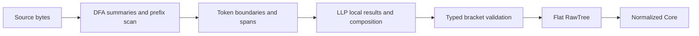

# Metal 言語処理系 の ナノパス設計

**Chez Scheme の段階文法、Harlan の GPU lowering、LIGO の変換と検査の分離を参考にし、Pareas 型の GPU 字句解析と構文解析を入口に置く構成**が、今回の目的に合う。Bend からは所有する値と明示的 continuation による実行モデルを借りる。最初の成果を byte 入力から GPU 常駐 AST までとし、CPU は正しさの照合と性能比較を担う。GPU 解析法と、意味を小さく分割するナノパスは別々に設計する。以下は **2026年11月15日時点の調査から導く設計案**であり、Metal 実装や速度測定の達成報告ではない。

## Chez と Harlan と LIGO から段階契約を借りる

Chez は、中間言語で許す形と消す形を定義する実用例として読む。変数情報の整合条件も、各段の保証を定める手本になる。Framework の `define-parser` が変換するのは **S 式から IR record へ**であり、文字列の lexer や GPU parser を生成する機能とは区別する。Racket CS は Chez を backend として使うが、Racket の reader と expander を含む前段全体が Nanopass という意味にはならない。([Chez の実用化論文](https://doi.org/10.1145/2500365.2500618)、[Framework のガイド](https://github.com/nanopass/nanopass-framework-scheme/blob/c14d392487886df9275c1d4a3f0f61e1b6c4f2ef/doc/user-guide.stex#L76)、[Racket CS 論文](https://doi.org/10.1145/3341642))

Harlan は歴史的な OpenCL 向け GPU 言語として、closure、kernel 次元、work size、region 引数、launch を明示する順序が参考になる。ただし Framework 製パスと S 式変換および `verify` を混用し、入力には CPU の Scheme `read` と `parse-harlan` を使う。LIGO は `Ast_unified` 上の morphism と禁止構文を調べる reduction を組み合わせ、最後に `Ast_core` へ移る独自方式である。段ごとに別型の IR を使う構成との比較に向き、構文前段は CPU で動く。([Harlan 論文](https://theincredibleholk.org/papers/oopsla2014.pdf)、[Harlan reader](https://github.com/eholk/harlan/blob/3afd95b1c3ad02a354481774585e866857a687b8/harlan/driver.scm#L62)、[LIGO の CST 変換](https://github.com/ligolang/ligo/blob/98081a730e3dc438790221c5190b11fb4ffc8f08/src/passes/03-unification/cameligo/compile.ml))

次の順に一つの構文の消去を追うと、文法、変換、GPU 境界、検証を結び付けられる。

| 順 | 読むコードと記号 | 新処理系で決める契約 |
|---|---|---|
| 1 | [Chez の np languages](https://github.com/cisco/ChezScheme/blob/d533f2e156d4eddeafe24bd7cc4de87fdc88caeb/s/np-languages.ss#L424) の `L1` 以降と `extends` | 追加する形と消す形を段階ごとに宣言する |
| 2 | [Chez の cpnanopass](https://github.com/cisco/ChezScheme/blob/d533f2e156d4eddeafe24bd7cc4de87fdc88caeb/s/cpnanopass.ss#L683) の `$np-compile`、`np-convert-assignments`、`np-convert-closures` | 呼出順、代入の箱化、closure 化を分ける |
| 3 | [Harlan の compile middle](https://github.com/eholk/harlan/blob/3afd95b1c3ad02a354481774585e866857a687b8/harlan/middle/compile-middle.scm) の `nanopasses` と `verify-*` | IR と S 式の境界、検査条件を追う |
| 4 | [Harlan の generate kernel calls](https://github.com/eholk/harlan/blob/3afd95b1c3ad02a354481774585e866857a687b8/harlan/middle/generate-kernel-calls.scm) の `M8 → M9` | region と引数を確定してから `apply-kernel` を launch にする |
| 5 | [LIGO の for to while loop](https://github.com/ligolang/ligo/blob/98081a730e3dc438790221c5190b11fb4ffc8f08/src/passes/04-nanopasses/passes/for_to_while_loop.ml#L133) の `compile` と `reduction` | 変換と残存形の検査を対にする |
| 6 | [LIGO の pass type](https://github.com/ligolang/ligo/blob/98081a730e3dc438790221c5190b11fb4ffc8f08/src/passes/04-nanopasses/passes/pass_type.ml) の `compile_with_passes` | validator をいつ実行するかを明示する |

## GPU パーサは字句の scan と構文の合成を分ける

直接の先例は、Futhark で字句から意味解析まで GPU 実行した **Pareas** である。Metal 用の完成部品ではなく、DFA 遷移関数の合成 scan と LLP の局所解析を移植する候補として読む。([Pareas 論文 第3章と第4章](https://theses.liacs.nl/pdf/2020-2021-VoetterRobin.pdf)、[Pareas 実装](https://github.com/Snektron/pareas))

字句段は chunk の開始状態ごとの遷移要約を結合的に合成し、prefix scan で入口状態を求めて局所走査する。最長一致には最後の受理位置と token の再開規則も必要で、境界 flag の scan と compact から `kind/begin/end` 列を作る。長い識別子、文字列の escape、コメントが chunk をまたいでも同じ token と byte span を返す契約にする。遷移を ID 化する場合、合成で閉じた遷移モノイドの要素数を `t` とすると、単純な合成表は `t²` になる。**DFA の状態数だけでなく、合成要約の種類と表生成の費用も採否に含める。** 無制限の入れ子コメントは有限 DFA だけでは扱えず、別の構造処理か仕様上の制限が要る。([Pareas 論文 字句解析](https://theses.liacs.nl/pdf/2020-2021-VoetterRobin.pdf))

構文段は、LLP 候補なら局所 lookback/lookahead から production または stack change を得て、offset scan と結合、型付き括弧の整合検査、親子関係の構築へ進む。括弧の対応だけで文法全体の受理判定が済むわけではない。Pareas は左再帰を除いた木から左結合を復元するため、`a-b-c` と優先順位を守る再構成も独立した契約にする。一般の LL や LR 文法の LLP(1,1) 適合は仮定せず、生成表の衝突を先に検査する。深さが求まっても matching と木の構築は残る。深い鎖、偏った木、長い演算列を分けて評価する。([Pareas 論文 第4章 特に4.5と4.8.1](https://theses.liacs.nl/pdf/2020-2021-VoetterRobin.pdf))

Bend の parser は `pos/indent` に加え、`parse_var` と `parse_patt` で scope や宣言表を参照する。そのままの移植を前提にせず、constructor 名分類などを名前解決へ送る範囲を決める。明示的 delimiter、型注釈、固定優先順位、少ない曖昧性は初期文法の仮説とし、汎用言語の必須条件とはしない。([Bend の Parse 状態](https://github.com/bendlang/bend/blob/f0cf0a7c573145501981c44d9c33e326185f008e/bend2/bend.ts#L338)、[Bend parser](https://github.com/bendlang/bend/blob/f0cf0a7c573145501981c44d9c33e326185f008e/bend2/bend.ts#L1540))

診断は `SourceId/revision/UTF-8 byte [begin,end)/origin` を維持し、GPU が error record を生成し CPU が安定順に表示する案とする。不正な宣言を隔離し、delimiter や次の宣言へ必ず進む回復規則を別に定義する。この回復は新設計である。IDE 用の lossless CST か、AST と元 token の対応かも選択点になる。

## 10 段階の契約を GPU 常駐 IR に与える

**提案する論理段階**は、字句と構文の後に書換えと意味検査を置く。schema から builder、validator、dump、CPU 参照変換を生成し、実装を置換可能にする。文法契約と自由変数や型の不変条件は別々に検査する。([設計の参照となる Chez の段階文法](https://github.com/cisco/ChezScheme/blob/d533f2e156d4eddeafe24bd7cc4de87fdc88caeb/s/np-languages.ss#L424))

| 段階 | 入力から出力 | 出力で保証すること |
|---|---|---|
| Lex | Source → Token | 最長一致、EOF、不正字句、元 span を明示し chunk 分割に非依存 |
| Parse | Token → RawTree | 文法を受理または拒否し、parent と child 範囲が整合。不正単位を隔離 |
| Normalize | RawTree → Core | 補助 node と糖衣を除去し、優先順位、結合性、評価順が確定 |
| Resolve | Core → Resolved | scope と宣言を構築し、全参照が可視な BinderId または GlobalId を持つ |
| CheckTypes | Resolved → Typed | 式と関数境界の型、arity、分岐が整合し、未解決 hole を流さない |
| CheckUses | Typed → Affine | 所有値の消費を経路ごとに高々一回とし move と borrow と drop を確定 |
| Close | Affine → Closed | 自由変数を順序付き環境にし、捕捉の所有権と寿命を明示 |
| ClassifyDevice | Closed → Classified | 到達呼出先と effect や capability を検査し、host 境界と理由を記録 |
| LowerExecution | Classified → ExecIR | 引数値と制御順、kernel または task の実行規約を明示 |
| Emit | ExecIR → Artifact | CPU と MSL の ABI、layout、依存、dispatch、完了契約が一致 |

表現は、tag、operand、parent、span の SoA 列と可変長辺の offset/data を基本にする。`NodeId<Generation>` と node 軸、scope 軸を区別し、別世代や別順序の列を混ぜない。scope 表、文字列 pool、型表は独立した状態として保持する。各段は論理件数 `n` と確保容量 `C` を分け、`n ≤ C` を GPU control buffer で保ち、後続は guard または indirect dispatch を使う。overflow と error record を必ず定義し、未完成の出力は成功段として公開しない。buffer owner と read/write 権限は最終 completion まで保持する。これは Bend の corpus とは別の flat IR 設計である。([Metal indirect compute command](https://developer.apple.com/documentation/metal/mtlindirectcomputecommand)、[CPU と GPU の同期](https://developer.apple.com/documentation/metal/synchronizing-cpu-and-gpu-work)、[Metal 4 の資源寿命](https://developer.apple.com/documentation/metal/understanding-the-metal-4-core-api))

この AST や SSA の列は **パスへの入力データとしての IR**である。map、scan、gather、rewrite を記述し kernel を生成する **パス計算の IR**は別層に置く。Nanopass の採用から、自動 GPU 並列化や走査融合までは得られない。LIGO は、A が作る新しい子を B が走査する場合は同じ traversal 群へ単純合成できないと警告する。また reduction は最終結果へまとめて適用するため、各パス直後の検査とは時点が異なる。段ごとの検証を保ち、依存と validator の位置を満たす範囲で融合する。([Framework の生成コード](https://github.com/nanopass/nanopass-framework-scheme/blob/c14d392487886df9275c1d4a3f0f61e1b6c4f2ef/doc/user-guide.stex#L2499)、[LIGO の合成条件](https://github.com/ligolang/ligo/blob/98081a730e3dc438790221c5190b11fb4ffc8f08/src/passes/04-nanopasses/passes/morphing.ml#L163)、[LIGO の検査時点](https://github.com/ligolang/ligo/blob/98081a730e3dc438790221c5190b11fb4ffc8f08/src/passes/04-nanopasses/passes/pass_type.ml))

## 生成先は直接 MSL と task evaluator から選ぶ

**処理系自身を GPU で動かす軸と、ユーザープログラムを GPU で動かす軸は独立する。** GPU parser とファイル入力、Apple shader toolchain、pipeline 作成、host IO の実行場所は分けられる。Bend の `comp.ts` も host compiler で、GPU 実行は生成された共通 evaluator が担う。([Bend compiler](https://github.com/bendlang/bend/blob/f0cf0a7c573145501981c44d9c33e326185f008e/bend2/comp.ts#L2784)、[BendRT](https://github.com/bendlang/bend/blob/f0cf0a7c573145501981c44d9c33e326185f008e/bend2/docs/BendRT/main.typ))

backend は意識的に選ぶ。直接 MSL へ落とす経路は、配列演算などの index、shape、address space、対応演算を確定し、host plan が kernel を起動する。Harlan の region と launch の段階化が参考になる。一方、ADT、closure、再帰的 task を中心にするなら、Bend 型の segment、value frame、tail/cut/fork、continuation、join slot を持つ flat evaluator が候補になる。後者には queue、stack、heap の容量と結果公開の規約が必要であり、affine 性だけで進捗や高速化を保証できない。最初は一方を完成させ、他方を同じ意味契約に接続する。([Harlan の region lowering](https://github.com/eholk/harlan/blob/3afd95b1c3ad02a354481774585e866857a687b8/harlan/middle/uglify-vectors.scm)、[BendRT の呼出しと task](https://github.com/bendlang/bend/blob/f0cf0a7c573145501981c44d9c33e326185f008e/bend2/docs/BendRT/main.typ#L197-L217))

汎用性は関数、制御、データ型、effect を段階的に増やして育てる。pure な関数でも、捕捉した外部 handle、未対応演算、確保、間接呼出のため device 不適格になり得る。呼出しグラフと effect の要約を検査し、IO request は host handler へ渡す契約を定める。affine 検査では排他的分岐の使用数を単純合算せず、同時に進む枝での二重消費を拒否する。LIGO の `linearity` は重複 binder や label の検査なので、そのまま所有値の使用検査には使えない。文法 validator は所有権や memory model の安全性証明を与えない。([BendRT の IO 境界](https://github.com/bendlang/bend/blob/f0cf0a7c573145501981c44d9c33e326185f008e/bend2/docs/BendRT/main.typ#L509-L524)、[LIGO の linearity](https://github.com/ligolang/ligo/blob/98081a730e3dc438790221c5190b11fb4ffc8f08/src/passes/04-nanopasses/passes/linearity.ml))

## 最初の到達点を GPU 常駐 AST に置く

第一段階は、関数定義、型注釈、let、block、if、call、複数の演算子優先順位を持つ小言語で、**bytes → GPU lexer → GPU parser → flat AST**を完成させる。汎用言語の構文的中核を試す範囲とし、行列演算だけに限定しない。文法表の host 生成と CPU oracle を用意しても、token ごとの CPU callback や readback は入れない。探索で文法と schema を固定し、失敗 fixture の Red、最小の Green、GPU 常駐を保つ refactoring と進む。

| 対象 | TDD の受入条件 |
|---|---|
| 字句境界 | 全 byte 位置に chunk 境界を置き、長い token、escape、comment、operator の kind と span が一致 |
| 構文と結合 | `a-b-c`、`a+b*c`、括弧、unary、if と call の木が oracle と一致し、不正な token 順も拒否 |
| 形状と容量 | 空入力、深い nest、偏った木、多数定義の batch で範囲外アクセスを起こさず、容量超過は明示的に失敗 |
| 診断と回復 | malformed input の code と span が決定的で、回復が進み、不正単位を隔離 |
| 次の意味段 | shadowing と constructor 名分類を parser から分離し、束縛先を照合。型違反を拒否。排他的分岐の各一回使用を許し、並列枝での二重消費を拒否 |
| 実行境界 | CPU と GPU の受理と出力が同値。毎段の件数 readback と completion 前の再利用を防ぐ |

oracle と性能 baseline は役割を分ける。同じ flat IR の SIMD と multicore に加え、CPU に適した走査削減も比較する。文法表生成と Metal library/pipeline 作成を含む cold、準備済みの warm、pass-only、診断消費込みの end-to-end を別々に測る。入力 bytes と node 数だけでなく幅、深さ、偏りを変え、p50/p95/p99、peak memory、中間 bytes、dispatch、global scan、host wait の回数を記録する。Pareas が指摘する反復走査と弱い baseline の問題を避けるためである。([Pareas 論文 第5章と第6章](https://theses.liacs.nl/pdf/2020-2021-VoetterRobin.pdf))

着手順は、文法の LLP 適合性と安定 schema の確認、GPU lexer、GPU の構造化と parser、小さい意味パス、runtime と backend とする。まだ決める必要があるのは、Unicode とコメントの規則、評価順、型推論の範囲、再帰と effect、host 実装言語である。後段の型体系を確定する前に、AST を GPU 内で正しく作れるかと、必要な scan とメモリ量を確かめられる。
