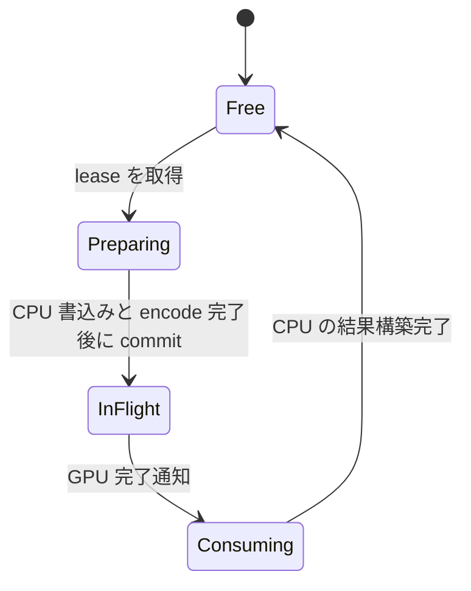

# CPU GPU バッチ実行の比較検証

CPU が独立入力を準備・回収し、その間に GPU が別入力のナノパス列を実行するバッチ処理を実装した。**256関数×8入力の summary 返却では、native batch の p50 は1 slotの17.29 msから3 slotの10.28 msへ短縮した。全 AST を返す場合は68.52→59.40 msで、CPU の結果構築と JSON 経路が引き続き大きい。** CPU/GPU 協調を実装できた一方、最適化した native CPU コンパイラとの性能比較はまだ行っていない。

調査・実装日: 2026-11-15。MSL 4.0、Apple M5、macOS 26.6.2。先の [実ワークロード評価](<CPU GPU 協調 の 実ワークロード評価.md>)のうち、独立した frontend 入力の重ね合わせと出力契約の比較を実装した。一般のユーザー関数の GPU 実行、CPU/GPU 自動配置、常駐 worker、公開 GPU IR handle は対象に含まれない。

## 実装した実行単位と所有期間

各 source が不変の入力 snapshot になり、一つの source／arena と一つの command buffer を使う。GPU は従来と同じ字句・構文・名前・型検査を連続実行し、中間 count を CPU に返さない。CPU は別 slot へ次入力を書き、完了した入力の結果を構築する。



[Apple の同期例](https://developer.apple.com/jp/documentation/metal/synchronizing-cpu-and-gpu-work)を踏まえ、completion handler は semaphore を通知する。ただし GPGPU の出力 slot は、その通知だけでは返却しない。CPU が診断・件数や AST を読み終え、GPU の arena を参照しない結果オブジェクトを作ってから lease を返す。入力と出力が同じ lease に属するため、入力側の buffer もその時点まで保持する。

責務は次のように分けた。

| 実装 | 責務 |
|---|---|
| [native/batch.h](../native/batch.h) | 最大1〜8 slot の FIFO、独立 job の発行、入力順の結果集約、保持容量の記録 |
| [native/flight.h](../native/flight.h) | 一度だけ submit／consume する future、完了通知、GPU 完了と CPU 消費までの資源保持 |
| [native/buffers.h](../native/buffers.h) | slot ごとの排他的 lease、再確保と容量管理 |
| [native/main.mm](../native/main.mm) | GPU パスの encode と、完了後だけに許す結果読出し |
| [src/contract.ts](../src/contract.ts)・[src/gpu.ts](../src/gpu.ts) | full／summary、同期／非同期の公開 API |

handler は future の生ポインタを捕捉せず、独立した通知状態を共有所有する。途中で例外が出た場合も、pending future の destructor が発行済み GPU の完了を待つ。pool を持つ Runtime は、その後に破棄される。FIFO の先頭が CPU 消費を終えるまで同じ slot を次の準備に使わず、結果も元の入力順で返す。これは独立入力用のスケジューラであり、前入力の結果に依存する次入力を先行実行する機能ではない。

## 公開 API

既定の `maxInFlight` は1とし、従来のメモリ使用を保つ。複数の入力を重ねるには `{maxInFlight: 3}` 等を指定する。`parseGpuBatch`／`parseGpuModules` は従来の全 AST を返す。追加した `checkGpuBatch`／`checkGpuModules` は同じ GPU パスを通し、診断と検査済み件数を返す。

```ts
import { checkGpuModulesAsync } from '../src/gpu.ts';

const future = checkGpuModulesAsync(sources, 64, 1, { maxInFlight: 3 });
// Node 側は独立した I/O、他 document の状態処理などを進められる。
const results = await future;
// result: valid / diagnostic / tokenCount / nodeCount / functionCount + 計測値
```

Promise を返す `checkGpuBatchAsync`／`checkGpuModulesAsync` は、呼出し時に入力を JSON snapshot に確定させる。呼出し元が配列を後で変更しても、その計算の入力は変わらない。document の版が変わった結果を採用するかは CPU 側で判断する。例えば document ごとに開始時の版を保持し、返却時の現行版と比較する。意味上の commit を実装したことや、言語の affine 使用検査・純粋性を形式検証したことは意味しない。

summary は AST・token・関数宣言の配列を構築しない。構文・名前・型の診断優先順位、UTF-8 byte offset、同段階で最小 offset/code の規則は変えない。失敗時の node／function 件数は0とし、未検証 AST を公開しない。全 token を返す既存 API と対応する token 件数は、失敗時も保持する。

CLI は複数ファイルを入力順に処理できる。

```sh
pnpm parse --module --summary --in-flight 3 a.np b.np
just bench-scheduling
```

## 同じ出力契約での比較

[全標本と source hashes](../measurements/apple-m5-scheduling-trial1.json)を保存した。1／3／8 slot と full／summary の6条件を、各 round で順序を回転させて比較した。入力は固定 hash の独立 module で、各関数に8項の算術式を持つ。2 warmup＋10 retained samples、各 job の `repeat=1`。full では全 job で AST を構築しており、最終一件だけを取り出す旧 benchmark とは異なる。

各 trial は新しい native process／library と空の pool を使う。OS の shader cache は消していない。native batch は最初の確保・初期化・encode・全 GPU 完了・全 CPU 結果構築を含み、library setup、JSON serialization、IPC、JS parse を含まない。API 時間にはそれらも含め、CPU oracle による一致確認は時間計測後に行う。CPU の最適化実装との速度比ではなく、同じ GPU 実装のスケジュール比較である。

| 入力 | 出力 | native p50・1 slot | 3 slot | 8 slot | 1→3 slot の速度比 |
|---|---|---:|---:|---:|---:|
| 1関数×32入力 | full | 25.47 ms | 10.85 ms | 6.93 ms | 2.35 |
| 1関数×32入力 | summary | 32.26 ms | 6.88 ms | 6.95 ms | 4.69 |
| 32関数×16入力 | full | 30.76 ms | 17.06 ms | 16.09 ms | 1.80 |
| 32関数×16入力 | summary | 20.57 ms | 7.58 ms | 6.93 ms | 2.71 |
| 256関数×8入力 | full | 68.52 ms | 59.40 ms | 57.43 ms | 1.15 |
| 256関数×8入力 | summary | 17.29 ms | 10.28 ms | 5.52 ms | 1.68 |

full と summary は出力契約が違うため、その間の差を同一処理の高速化率にしない。特に小さい入力で summary の1 slot が full より遅かった点からも、実行順序を回しても周波数・OS 負荷等を完全には制御できていない。10標本の参考値であり、普遍的な閾値にはしない。

256関数×8入力について API 全体と保持容量まで含めると、次になる。

| 出力 | slot | native p50 / p95 | API p50 | Metal buffer 容量の peak |
|---|---:|---:|---:|---:|
| full | 1 | 68.52 / 112.87 ms | 286.36 ms | 4.03 MiB |
| full | 3 | 59.40 / 63.00 ms | 282.68 ms | 12.09 MiB |
| full | 8 | 57.43 / 62.43 ms | 275.48 ms | 32.25 MiB |
| summary | 1 | 17.29 / 18.82 ms | 59.08 ms | 4.03 MiB |
| summary | 3 | 10.28 / 11.54 ms | 51.21 ms | 12.09 MiB |
| summary | 8 | 5.52 / 9.07 ms | 48.60 ms | 32.25 MiB |

full は CPU の AST オブジェクト化と、その後の JSON／IPC／JS parse に大きな費用が残る。別々の p50 の差をその費用の測定値にはせず、API の改善幅が小さいという観測に留める。summary でも process 起動と setup が残るため、native batch の改善率を API 全体へ外挿できない。今回の結果から、常駐 worker と小さい返却形式の優先度は高いと考える。

## 重ね合わせの確認と計測上の制約

`flightSamples` は、CPU の準備開始・submit、Metal が報告する GPU start/end、completion handler の通知、CPU 消費の開始・終了を同じ host clock 上で記録する。GPU timestamp が得られない場合は null を返す。GPU start/end は command buffer の実行区間であり、各 GPU core の active cycle を測るものではない。

保存した標本では、1 slot の準備／消費と GPU 区間の重なりは0だった。3 slot・32関数×16入力の full では、CPU 消費と GPU 区間の重なりの p50 が約10.01 ms、準備側は約0.18 msだった。独立入力間の重ね合わせは確認できる。ただし全改善をこの交差時間だけに帰属させられない。queue の空き、GPU 側の実行区間や動作条件も変わりうる。

`peakLeasedSlots` は GPU 完了後の CPU 消費待ちも含む。これを GPU の同時演算数とは呼ばない。`peakBufferBytes` は inactive な pool slot も含む source／arena の確保容量で、RSS ではない。slot 増加には容量の増加と FIFO 待ちが伴い、3が常に最適という前提も置かない。

従来の `elapsedUs` は入力準備開始から CPU が完了を観測するまで、`submitWaitUs` は encode 後からその時点までである。複数 slot では、他入力を CPU で準備・構築する経過時間も入る。入力ごとの値を足すと重複するため、batch 比較には `batch.wallUs` を使う。`completionWaitUs` は通知を待つホスト区間で、GPU 演算や通知遅延を含み得る。readback 単独の時間ではない。

## 検証と次の境界

`just test` の31件が通過した。1／2／3／8 slot、fresh／reuse／selective、長い入力から短い入力、エラーから正常、空入力、UTF-8、診断 layout の切替を確認した。poison した buffer でも CPU oracle と AST・診断が一致し、同じ slot の次の準備が前の CPU 消費終了より後になること、ring を埋める前に全 job を直列消費していないことも trace で検査した。非同期入力 snapshot と、発行済み job を残した例外経路も検査した。

`just validate` は API/GPU validation を有効にし、式4件＋module13件×診断3方式×buffer3方式×slot数1/3×full/summary の612実行が通過した。複数ファイルの CLI summary も実行確認した。詳細な手順は [検証記録](<../research_notes/CPU GPU バッチ実行の比較検証/verification.md>)に保存する。

次は常駐 worker で起動・library setup を償却した状態と、同じ出力の native CPU baseline を比較したい。真の結果依存の費用を見るには、別途、同じ有効仕事のまま CPU feedback 回数だけを増やす実験が必要になる。今回の複数 buffer でその依存を消したとは結論しない。MSL 4.1 への更新は今回も必要なかった。
