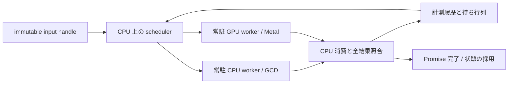

# CPU GPU 自動配置の検証

**CPU と GPU の常駐 scheduler を実装し、反復計測から配置を選び、プロファイルを次回起動へ引き継げるようにした。** 対象は先に検証した Merkle SHA-256、histogram256、安定 compaction の3種類。今回の最適化は登録済み計算の配置であり、任意の言語プログラムの自動 GPU 化は含まない。

2026-11-15、Apple M5／10 logical CPU／macOS 26.6.2／MSL 4.0。[試行1](../measurements/apple-m5-adaptive-trial1.json)・[試行2](../measurements/apple-m5-adaptive-trial2.json)は commit `251b136` の同じソース。[試行3](../measurements/apple-m5-adaptive-trial3.json)は lease の所有期間のコメントと末尾空行だけを修正した最終ソースで、処理内容は同じ。MSL 4.1 と OS 更新は不要だった。

## スケジュールする単位

一つの純粋な仕事を、CPU 単一、CPU GCD 並列、GPU のいずれかへ配置する。CPU と GPU で別の仕事を同時に進められる。GPU の Merkle 各階層や scan の各段は一つの command buffer に連結し、その途中へ中央 scheduler を戻さない。完了後に CPU が全結果を消費・照合してから次の仕事へ進む。



中央には I/O、待ち行列、profile、資源解放を置く。実行中の仕事は移動・分割しない。型検査の各ノードのような小粒度の callback にこの scheduler を挟む設計ではない。

CPU worker は Metal を初期化せず、GPU worker だけが library／pipeline／queue を保持する。各 worker に一つずつ仕事を流す。現在は別 native process と JSONL 接続なので、Node の I/O を止めずに実験できる。CPU/GPU の入力は別 replica であり、両 process が同一の host allocation を zero-copy で共有する実装にはなっていない。単一 native process 内の CPU thread pool と Metal queue へ移す余地がある。

## 学習と再探索

`run` 自体が学習する。既定では各候補の実測が3件揃うまで候補を試し、その後は中央値を使う。`calibrate` は別途、各候補を1回 warmup してから3件ずつを順序回転して計測する。通常の自動学習では初回実行も履歴に入るため、cold の影響は同じではない。

| 方策 | 実装した規則 |
|---|---|
| 費用 | worker RPC 開始から応答までの service wall time。GPU 内部時刻だけを使わない |
| 観測窓 | 単独／CPU-GPU 重複のそれぞれ直近9件。適合する文脈が3件未満なら全観測へ戻す |
| 切替え | incumbent より10%以上速い候補へ変更。CPU 単一／並列にも適用 |
| 待ち行列 | `推定残り待ち + 自身の推定 service` が小さい processor を選べる。先行する待ち仕事の予約分も加える |
| 再探索 | 学習対象の配置64回ごとが機会。代替候補の経過観測数が `64 × max(1, 代替費用 / 採用費用)` 以上なら、古い候補を試す |
| 保存 | raw 観測・incumbent・使用順序。既定24時間で観測失効。最大256 profile key |

`contended` は二つの RPC の実行期間が重なった印で、GPU の実稼働周期やメモリ帯域 counter を計った値ではない。CPU/GPU の共有資源競合を分類する近似であり、他アプリの GPU 利用、電力状態、投入間隔を直接識別しない。

profile key はアルゴリズム、正確な件数、compact の mask、実際の入力の特徴、入力配置から作る。histogram は最大 bin 比率、compact は実際の選択率を分類する。宣言した distribution だけを信用せず、たとえば seed=0 の生成列も実際の偏りで分類する。seed 自体は key にせず、別入力でも同じ形状の履歴を使う。サイズの補間モデルはまだ持たない。

fingerprint は worker binary、MSL、scheduler 関連ソース、出力・検証契約、機種、CPU、OS、Node/V8、検証設定等を含む。更新後に古い性能を引き継がない。保存は一時ファイルと atomic rename で、壊れた JSON・不正な数値・異なる fingerprint は採用しない。同じ profile path の複数 writer を調停する lock はない。

## 所有期間と上限

`prepare` は生成入力、CPU scratch、全結果の基準、GPU source／arena を準備する。生成前に予約容量を見積もり、既定1 GiBを超えたら拒否する。8 handle、受理済み16 job が既定上限。これは論理予約で、driver／process／allocator を含む RSS の制限ではない。大 compaction の CPU/GPU 両 replica の予約は約577 MiBになった。

`runBatch` は空きを待って投入し、結果を入力順に返す。直接の `run` が満杯なら拒否する。`release` はその handle の受理済み処理を待ち、`close` は全受理済み処理を drain し、GPU completion と CPU 消費後に解放・終了・保存する。GPU 故障や結果不一致を CPU 再実行で隠さない。

`gpu-upload` は実行ごとに host replica から shared Metal source へ copy する。`resident` 指定だけがこの copy を省く。ただし CPU 側の replica も準備済みという実験契約で、任意の GPU-only buffer からの CPU 移動費用は扱わない。計算結果の memoization はしない。毎回、全計算と全要素照合を実行する。

## 単発の配置結果

各候補の校正後、CPU 単一／並列、GPU、auto を順序回転して各15件測った。固定候補は学習履歴を更新せず、auto は更新する。次は試行2の API 呼出しから完了までの p50、単位 ms。確保・初回準備・校正を除くが、JSON／IPC・全出力検証は含む。

| 入力 | CPU 単一 | CPU 並列 | GPU | auto | auto の15件 |
|---|---:|---:|---:|---:|---|
| compact・65,536 u32 | 0.074 | 0.071 | 0.268 | 0.085 | CPU 単一 |
| compact・16,777,216 u32／64 MiB | 5.326 | 2.901 | 7.432 | 2.914 | CPU 並列 |
| Merkle・262,144葉／16 MiB | 82.600 | 12.544 | 17.923 | 12.595 | CPU 並列 |
| histogram・16 MiB、CPU 入力 | 3.423 | 0.915 | 2.103 | 0.954 | CPU 並列 |
| histogram・16 MiB、GPU 常駐 | 3.148 | 0.915 | 1.657 | 0.921 | CPU 並列 |

試行1も大 compact、Merkle、histogram は CPU 並列を選んだ。小 compact は CPU 並列を選び、auto 0.127 ms、固定 CPU 並列0.089 msだった。実際の native compute は約16〜17 µsしかなく、IPC と配置判断の相対費用が大きい。この粒度なら batch 内の native scheduler に寄せる方が検討に値する。

大 compact は試行2で GPU 固定の約2.55倍の速度になった。一方、既知の CPU 並列に対しては同程度で、自動配置自体がアルゴリズムを速くしたわけではない。10%以内の差には切替えを抑えるため、小 compact でも観測上の最小方式を毎回採る仕様ではない。

前の [アルゴリズム比較](<CPU GPU アルゴリズムの比較検証.md>)では、大 Merkle の GPU コピー込みは5.304 msで CPU より速かった。今回の交互実行では GPU 17.923 ms、連続投入では約5 ms/件へ変化した。時間の範囲にも検証／IPC の違いがあるが、GPU の投入パターンによる差も大きい。周波数や他負荷を測定・制御していないため、原因を一つに断定しない。固定の「入力何 byte なら GPU」という境界を保存する方法では不十分だった。

試行3では、同じ交互実行の Merkle が CPU 並列13.885 ms／GPU 6.164 msになり、auto は15件すべて GPU を選び5.884 msだった。大 compact は CPU 3.002 ms、histogram は CPU 約0.99 ms。常駐 histogram の固定 CPU 0.948 ms／GPU 0.946 msには10%の差がなく、CPU を継続した。コードの性能改善を行っていない再試行でも GPU の状態が変わり、実測に従って選択結果も変わった。

## 学習にかかる費用

試行2の常駐 worker 起動は32.290 ms（試行1は34.712 ms）。OS の Metal cache を無効化した cold build の値ではない。校正には3候補それぞれ warmup 1回＋保持3回の計12実行がある。

再ビルド後の試行3では起動388.033 ms、Merkle の準備122.129 ms・校正445.862 msだった。初期化の状態によって起動費も大きく変わるため、32 msを一定の起動費として見積もらない。

| 入力 | 準備 ms | 校正 ms |
|---|---:|---:|
| compact 小 | 0.675 | 4.101 |
| compact 大 | 60.714 | 72.608 |
| Merkle 大 | 114.916 | 440.186 |
| histogram CPU 入力 | 32.491 | 27.561 |
| histogram 常駐 | 32.889 | 24.304 |

Merkle の校正は遅い CPU 単一候補を試す費用が支配する。試行1も454.134 msだった。準備は基準結果の計算を CPU/GPU worker の双方で行うため、実用の入力受渡しだけより重い。起動・準備・学習を除外して「初回から高速」とは言えない。

大 compact で同じ状態が続くと仮定すれば、GPU 固定との差約4.518 ms/件に対し校正72.608 msは約17反復で回収する計算になる。これは校正追加分だけの概算で、cold 全体の実測 break-even ではない。既知の最速 CPU に対して校正費を回収できたという結果でもない。プロファイルの再利用で校正を省けることが重要になる。

## 両方を使えば速くなるか

同じ大 Merkle を16件投入し、GPU 固定、adaptive、履歴更新後の adaptive を3 round、順序回転して測った。各 batch の前には GPU の同形状 warmup を入れた。仕事は同一 immutable 入力だが毎回再計算する。adaptive の履歴は round 間で引き継ぐ。

| 試行 | GPU 固定の中央値 ms | adaptive の中央値 ms | 更新後 adaptive の中央値 ms |
|---|---:|---:|---:|
| 1 | 80.804 | 81.853 | 80.206 |
| 2 | 80.839 | 80.775 | 80.836 |
| 3 | 80.623 | 75.003 | 74.060 |

試行1／2の adaptive は概ね CPU 6件＋GPU 10件に配った。両 lane の RPC が重なり、結果も一致した。しかし GPU 固定と概ね同じ時間で、安定した throughput 改善は確認できなかった。単発の速さだけを足し合わせた理想値にはならない。CPU 実行が GPU の帯域や host 発行・消費と競合する可能性があり、独立した仕事でも両方を埋めればよいとは限らない。

試行1の更新後には72.155 msの batch もあったが、3件の中央値は80.206 ms。試行2の GPU 固定にも97.889 msの外れた batch がある。一つの良い／悪い batch だけを選んで速度比を主張しない。3 round は記述的な測定で、統計的な優位を確定する標本数ではない。

試行3は CPU 4〜5件＋GPU 11〜12件へ配り、中央値では GPU 固定より約7〜9%短かった。ただし更新後 adaptive の範囲は72.263〜87.398 msで、GPU 固定を超える batch もある。試行1／2の利益がほぼなかった結果も残し、安定した並行実行の利益を確定したとは扱わない。

再起動後は profile status が `loaded` になり、別 seed の同形状 Merkle を追加校正せず試行1／2は CPU 並列、試行3は GPU へ配置した。入力そのものを cache して結果を返しているわけではない。

## 言語実装へつなぐ範囲

今回の形なら、CPU が版・I/O・依存関係を管理し、十分な大きさの純粋領域を CPU/GPU 候補へ配置する構成を試せる。アムダールの直列項には scheduler／RPC／状態の採用も含まれるため、pass の中の各要素を仕事にせず、一連の scan／map／reduce をまとめた領域を境界にする必要がある。

現状は生成レシピだけを受け、結果 API は checksum／件数／Merkle root と検証情報を返す。任意配列の登録、結果 buffer を次の処理へ渡す DAG、GPU-only 所有権、CPU/GPU 共通の純粋 IR、コード生成、kernel fusion、threadgroup size 等の自動探索は未実装。frontend には契約が揃った native CPU 版がないため、自動配置の対象に加えていない。

次に性能を伸ばす候補は、単一 native process での資源共有、投入間隔／連続実行の profile 分離、lane を同時使用すること自体の throughput 比較である。現 scheduler の「予測完了が早い processor」規則は、他方を遅くする外部効果までは最適化していない。

## 実装と再実行

[src/adaptive-policy.ts](../src/adaptive-policy.ts) に純粋な選択規則、[src/adaptive-profile.ts](../src/adaptive-profile.ts) に履歴の検証・保存、[src/adaptive.ts](../src/adaptive.ts) に待ち行列・所有期間、[src/adaptive-worker.ts](../src/adaptive-worker.ts) に接続を分離した。[native/workload-worker.mm](../native/workload-worker.mm) は常駐プロトコル、[native/workloads_runtime.h](../native/workloads_runtime.h) は単発 benchmark と共有する native 実行系。CPU/MSL のアルゴリズムは今回変更していない。

`just test` の48件、`just validate` の750 GPU 実行が通過した。通常実行だけでの学習、性能変化後の再探索、noise margin、queue、競合履歴、保存と無効化、worker PID の継続、上限、release／close の待機、worker 障害時の拒否を確認した。Metal validation では poison を使い、正常終了時にも stderr の検証エラーを確認する。

```sh
just test
just validate
just bench-adaptive
```

全標本・phase・校正費・source hashes・再利用した保存 profile は測定 JSON に含む。[検証記録](<../research_notes/CPU GPU 自動配置の検証/verification.md>)に手順と費用の範囲を残した。過去のアルゴリズム計測は元の source hashes のまま保持している。
