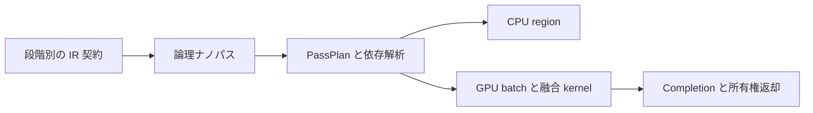

# Metal GPU 言語処理系 の 設計最適化

当面の実装検証は **MSL 4.0** で続け、4.1への環境更新は延期する。以下の4.1要件は将来の対象。診断集約の初回実験は [比較検証](診断集約の比較検証.md) に保存し、tree 基準149 dispatchから既定の packed 方式77 dispatchへ減らした。以下の149 dispatchの監査と初回 snapshot は tree 方式の基準記録として読む。

**関数・block を segment として持つ列 IR を中心にし、ナノパスの意味上の契約と、GPU の走査・カーネル起動を分離する設計へ進める。** 文法は明示的な境界と型付き signature を持たせ、処理は関数群をまとめて GPU に常駐させる。最初の実装変更は、現行149 dispatch のうち76回を占める診断 reduction の削減と、runtime・arena の再利用である。この件数比を実行時間の割合とはみなさない。2024–2026年の研究は、文法生成、平坦な構造、scan、fusion の各層に採れるものがあり、一つの方式への全面置換を支持してはいない。以下は **2026年11月15日時点の調査と現行コードの監査に基づく v2 案**であり、最適化後の性能報告ではない。

## v2 の基準は最新の MSL 4.1

v2 は **MSL 4.1、macOS 27以降、macOS 27 SDKを含む Xcode 27以降**を基準にする。旧 MSL 向けの互換経路を v2 の設計要件に含めず、4.1 の acquire/release atomics と device-scoped synchronization を使える条件で scan・worklist を設計する。ビルドと実行時のコンパイルでは言語バージョンを明示し、shader 内の `__METAL_VERSION__ == 410` も確認する。将来の MSL 更新時には対象バージョンと性能・正しさの基準値を一緒に更新する。([Apple の MSL 4.1 availability](https://developer.apple.com/documentation/metal/mtllanguageversion/version4_1)、[言語バージョン指定](https://developer.apple.com/documentation/metal/mtlcompileoptions/languageversion)、[Xcode の対応 SDK](https://developer.apple.com/xcode/system-requirements))

現在の試作・計測は macOS 26.6.2／Xcode 26.4／SDK 26.4 の環境で得た v1 の結果である。この環境で4.1を明示してコンパイルすると `invalid value 'metal4.1'` と拒否された。先の「4.0指定で release 構文が失敗した」という検査とは別に、4.1自体が使えないことを確認した。v2 の実行確認には SDK と OS の更新が必要であり、これは M5 のハードウェア非対応を意味しない。Xcode 27自体は macOS 26.6以降で起動できるが、MSL 4.1 の API availability は macOS 27以降である。

## 149 dispatch の内訳から固定費を減らす

保存済みの M5 計測では、256関数・77,713 bytes・48,896ノードを、8論理パス／149 dispatch で処理している。frontend 中央値は **1.783 ms**、GPU device interval は **0.624 ms**、arena は約11.8 MB。frontend は確保・初期化・encode/submit・最後の wait を含み、library/pipeline setup と最終 JSON 化を含まない。二つの中央値の差から、純粋な readback 時間や host overhead を分解することはできない。([計測とソースハッシュ](../measurements/apple-m5.json)、[計測区間](../scripts/bench.ts))

`diagnose` は source bytes を上界にした tree を seed し、17階層を reduce し、結果を publish する。この入力では一回19 dispatch、4回で **76 dispatch** となる。まず threadgroup ごとの最小値から最終値を作る階層 reduction と、エラー発生時だけ `atomic_min` する方式を比較できる。現在の上限1 MiB・error code 最大18なら `(offset << 5) | code` は u32 に収まる。`code < 32`、offset の上限、sentinel との非衝突を契約にし、容量・ABI の変更時に再検査する。ただし構文→名前解決→型の**段階別キー**を持ち、同じ段階の全診断を集約する。重複宣言を見つけた直後に未定義名検査を止めると、より前の位置のエラーを失う。([現行 diagnose と発行順](../native/main.mm)、[現行診断](../native/frontend.metal))

実 API の固定費はこの1.783 msより大きい。TS adapter は呼出しごとに子プロセスを起動し、snapshot では約28–33 msの library/pipeline setup が別にかかる。`sources` 配列も native 側で一件ずつ実行・待機しており、複数 source を同時に詰めた GPU batch ではない。**常駐 compiler service、サイズ別 arena pool、実際の packed batch**を先に設計する。pool は completion まで所有権を保持し、前回より短い入力でも古い列が見えない初期化契約を持たせる。([adapter](../src/gpu.ts)、[native runtime](../native/main.mm))

## 2024–2026年の手法は文法と配列と実行を別々に改善する

GPU 上で compiler 自身を動かす直接の先例は、引き続き **Pareas** の小言語 compiler である。GPU 向け compiler である Futhark や Hercules の最適化は、compiler 自体の GPU 実行とは区別して借りる。([Pareas 著者実装・CF2022論文情報](https://github.com/Snektron/pareas)、[Hercules 論文、2025](https://arxiv.org/html/2503.10855v1))

| 資料 | 採る設計 | 適用範囲 |
|---|---|---|
| **An LLP(q,k) Parser Generator**、ARRAY 2024／Alpacc | 文法から局所解析の表を生成し、preorder 配列・parent index・UTF-8 span を出す | 会議概要と現行著者実装を確認。任意の LL/CFG が LLP に収まるとはしない。([会議](https://pldi24.sigplan.org/details/ARRAY-2024-papers/2/An-LLP-q-k-Parser-Generator)、[実装](https://github.com/diku-dk/alpacc)) |
| **Boosting Parallel Parsing through Cyclic Operator Precedence Grammars**、SLE 2025 | リストを平坦な可変長構造として扱い、局所解析を並列に結合する | Go の CPU 並列実験。GPU の実測ではない。([論文記録・本文](https://repositum.tuwien.at/handle/20.500.12708/217251?mode=full)) |
| **Decoupled Fallback: A Portable Single-Pass GPU Scan**、SPAA 2025 | 待たされた tile を別 group が再計算し、forward progress に依存する待機を避ける | Apple M1 Max／M3 の実測は Dawn/WebGPU。native Metal 移植と9状態 DFA 合成の性能は別検証。([論文](https://escholarship.org/content/qt0bk9z4bt/qt0bk9z4bt.pdf)、[artifact](https://github.com/b0nes164/Decoupled-Fallback-Paper)) |
| **cuJSON: A Highly Parallel JSON Parser for GPUs**、2025公開／ASPLOS 2026 | 構造文字位置と対応位置を配列で返し、再帰オブジェクト木を作らない | 著者コードを確認。JSON 専用で、論文本文の性能倍率はここでは採らない。([実装](https://github.com/AutomataLab/cuJSON)、[DOI](https://doi.org/10.1145/3760250.3762222)) |
| Futhark **Scan-scatter fusion**、2026-03-24 | scan の最終書出しに consumer/scatter を融合し、中間列を減らす | 著者実装解説。記事時点では未完成、chain 内 scan 一つという範囲。([公式記事](https://futhark-lang.org/blog/2026-03-24-scan-scatter-fusion.html)) |
| Futhark **Full flattening of nested data parallelism**、2026-07-31 | 不均一な内側処理を segmented primitives へ落とし、粒度に応じて逐次化も選ぶ | 著者解説に加え v0.27.1 release で実装入りを確認。Metal backend の実証ではない。([記事](https://futhark-lang.org/blog/2026-07-31-full-flattening.html)、[release](https://github.com/diku-dk/futhark/releases/tag/v0.27.1)) |

この試作では **LLP/C-OPG を文法の候補、cuJSON を構造 ABI の参考、Futhark を列処理と schedule の参考、Decoupled Fallback を scan 基盤の候補**として使う。ARRAY 2024 の *Nano-parsing* は APL の文脈依存構文を扱う研究で、Nanopass Framework と同じものではない。今回は公式概要までの確認なので、主要な置換案の根拠にはしない。([Nano-parsing 会議概要](https://pldi24.sigplan.org/details/ARRAY-2024-papers/9/Nano-parsing-A-Data-parallel-Architecture-for-Perverse-Parsing-Environments))

## v2 は対応括弧と region を先に確定する

次の言語範囲は、**明示型の関数・call・単一代入の `let`・構造化 `if`**とする。全 signature を本体より先に集めれば、直接 call の型確認は callee 本体の推論完了を待たない。block は `{}`、call は `()`、文は `;` で区切り、識別子の字句分類を宣言表に依存させない。固定優先順位、非入れ子コメントから始め、implicit conversion、overload、型計算を伴う構文判定は増やさない。これは並列依存を限定する設計案であり、**この条件だけで LLP になるとは保証しない**。Alpacc 等へ文法を渡し、必要な q/k、衝突、表サイズ、生成時間を確かめる。

```text
fn choose(flag: bool, x: u32, y: u32): u32 {
  let z: u32 = add(x, 1);
  if flag { z } else { y }
}
fn add(x: u32, y: u32): u32 { x + y }
```

現在の逆向き min scan が求める「次の `}`」は nested block に使えない。v2 では文字列・コメントを除外した delimiter に、型付きの対応位置と親 region を与える。総深さがゼロでも `([)]` は拒否する。`fn` の位置だけを独立した境界とみなさず、対応括弧・region が保証する宣言境界を使う。括弧一致とは別に文法の受理判定も残す。([現行関数索引](../native/module.metal)、[Pareas の括弧・木構築](https://theses.liacs.nl/pdf/2020-2021-VoetterRobin.pdf))

以下を **v2 の論理 IR 契約**とする。段階は検証可能な view であり、毎段別 buffer へコピーする指定ではない。

| IR | 列・索引 | 保証 |
|---|---|---|
| `SourceBatch` | byte slab、file offsets、revision、owner | 入力区間が非重複で、in-flight 中に変更されない |
| `TokenColumns` | kind、fileId、byte span、NameId、count/capacity | span が入力内。NameId の等価性は実 byte 列で確定 |
| `RegionScopeColumns` | delimiter pairs、parentScope、関数・block・signature の範囲 | 型付き括弧と所属 region が整合 |
| `ResolvedNodeColumns` | owner、binder/callee ID、operand offsets/IDs | 全参照が可視な宣言へ束縛 |
| `TypedRegionANF` | typed value、let、call args、if args/yields | 型・単一代入・評価依存が明示 |
| `OwnershipCheckedIR` | move/borrow mode、region 使用要約 | 実行経路と並列枝の所有権規則を満たす |
| `PassPlan → TaskGraph` | map/scan/compact/join、read/write 集合、依存辺、completion | 意味を保つ融合・配置・資源再利用を選ぶ |



宣言列・文列・引数列は `offset/count + children[]` にし、固定二分木の `Sequence` の鎖にしない。演算子列を平坦化する場合も `a-b-c` の左結合と operand の評価順を保持する。**構造の平坦化と算術の再結合は別**である。source は UTF-8 byte span を正本とし、NodeId の世代・配列軸も区別する。増分 cache は定義キー・body/signature hash・依存版で識別し、関数相対 span と file origin を分ける。文字列やコメントの入口状態が変わる編集は、後続 chunk へ影響し得る。

名前は衝突を検証した NameId を intern し、小 scope では整数の線形探索、大きい宣言表では sort/join・hash を構築費込みで比較する。`(scopeId, NameId)` の一致だけで shadowing と使用位置は解けないので、初版は shadowing を制限し、可視区間と親 scope を契約に含める。2025年の配列言語向け hash map 研究も、配列語彙だけの実装が CUDA の専用 map より有利とは示していない。([Towards Efficient Hash Maps in Functional Array Languages](https://arxiv.org/html/2508.11443v1))

affine は Copy scalar と owner を分け、alias のない構造化 core から検査する。各 owner の使用要約を `{0,1,2+}` とし、逐次・同時実行する fork は飽和加算、排他的 `if` の枝は最大値、条件評価分はさらに加算する。`if c { consume(x) } else { consume(x) }` は受理できるが、その後の再消費は拒否する。全 node×全 binder の密な行列を作らず、region の疎な要約を合成する。これは限定 core 向けの提案であり、loop、closure、共有 borrow の一般解析は追加規則を要する。([分岐の context 規則](https://raw.githubusercontent.com/jespercockx/lbss-lecture-notes/master/07_substructural_type_systems.md))

## 物理実行は scan と同期の実測から選ぶ

最初の融合候補は start scan→token scatter、node flag scan→node scatter、名前解決→既知型 seed、局所型検査→診断集約である。global prefix の伝播は省略せず、最終書出しへ consumer を入れて rank 等の中間列を減らす。検証用 schedule は途中 IR を保存し、最適化用 schedule は liveness に従って列を再利用する。barrier を含む kernel では無効 lane も identity/mask で参加させる。

現行256要素の局所 Hillis–Steele scan は17回の threadgroup barrier を使う。まず SIMD 内 scan と、SIMD ごとの少数の合計だけを共有する階層方式を比較する。幅は `threadExecutionWidth` から得て固定値にしない。sum intrinsic と min／非可換な DFA 遷移合成は別実装・別検証になる。その後に Decoupled Fallback を試し、u32 sum の結果を9状態の合成へ一般化しない。([現行 scan](../native/frontend.metal)、[Apple の threadgroup 指針](https://developer.apple.com/documentation/metal/creating-threads-and-threadgroups)、[MSL SIMD 規約](https://developer.apple.com/metal/Metal-Shading-Language-Specification.pdf))

後段の仕事量は GPU の token/node count から indirect 引数を作って指定できる。これは旧 Metal にもある API であり、MSL の版と host の command API の版は区別する。v2 の host 実行計画には Metal 4 の allocator／argument table と明示的な依存関係を採る。旧 encoder の default serial／tracked resource と、Metal 4 の concurrent／untracked は同期責任が違うため、v1 の暗黙同期を v2 の保証に使わない。shared の ingress/egress と GPU 内 scratch を分離し、private storage も比較するが、UMA 上で private が必ず速いとは置かない。([間接発行](https://developer.apple.com/documentation/metal/specifying-drawing-and-dispatch-arguments-indirectly)、[同期モデル](https://developer.apple.com/documentation/metal/resource-synchronization)、[storage mode](https://developer.apple.com/documentation/metal/choosing-a-resource-storage-mode-for-apple-gpus))

2026-06-04版 MSL 仕様は4.1の acquire/release atomics と3.2以降の device fence を記載する。v2 は4.1の意味に基づいて producer/consumer の可視性を設計し、順序指定を削る最適化は litmus test と実行結果で検証する。新しいメモリ順序があっても、未実行の workgroup を待つ global spin の終了保証にはならない。単一パス scan や persistent scheduler の採用には、oversubscription を含む終了性検査を別に置く。([MSL §6.16](https://developer.apple.com/metal/Metal-Shading-Language-Specification.pdf)、[v1環境の probe 記録](<../research_notes/Metal GPU 言語処理系 の 設計最適化/metal_runtime.md>))

CPU/GPU の選択単位は、連続した関数群・region とする。短い関数は thread/SIMD-group 内、大きい関数は segmented な並列処理という複数 schedule を比較し、queue 待ち、確保・発行、同期、CPU consumer までの終了時刻を評価する。意味パスごとの往復や、exact count を配置器に返すためだけの wait は増やさない。切替閾値は同じ IR 契約を満たす **native CPU baseline**から決め、CPU に適した別アルゴリズムも認める。

ユーザープログラムの実行 backend は、事前コンパイルした IR interpreter/operator kernels と、MSL を生成して host compiler に渡す経路を別に扱う。GPU frontend や GPU 生成 ICB が、任意の新しい MSL を GPU 内でコンパイルする機能を与えるわけではない。([Apple の compiler と Metal 4](https://developer.apple.com/videos/play/wwdc2025/205/))

## 最初の五変更を同じ入力で採否判断する

各変更は既存の受理・拒否・AST・束縛・型・診断順を固定する Red→Green→Refactoring で進める。小さい式だけでなく、同じ総 node 数で関数数・最大 region 長・深さを変え、長い comment/string、名前参照が多い入力、正常／異常入力、小編集を含める。

| 順 | 最初の変更 | 採用を判断する測定・検査 |
|---|---|---|
| 1 | 診断 tree を階層 reduction／段階別 packed `atomic_min` と A/B 比較 | **既存16テスト・204宣言破壊ケース**、EOF、同位置 code 順、段階優先順位、GPU validation を維持。dispatch 件数と全体時間を併記し、異常入力での atomic 競合も測る |
| 2 | 常駐 runtime、PSO・arena pool、複数 source の実 packed batch、native CPU baseline | cold CLI／warm request／batch throughput を分離。allocate・zero/fill・encode・commit/wait・結果消費を計測。長入力の直後の短入力、失敗後の再利用、in-flight の破棄・再利用を検査 |
| 3 | SIMD 階層 scan、count による indirect dispatch、合法な scan/scatter fusion | 端数・空・複数 tile・3階層 scan・非可換合成の一致。中間 bytes、無効 thread 数、peak memory と E2E を比較。Fallback はその後の独立候補 |
| 4 | v2 文法の生成器検査、型付き対応括弧、region と可変長 children 列 | 表サイズ・q/k・生成時間を記録。`([)]`、nested block、全 chunk alignment、文字列内 delimiter を照合。隣の関数へ辺が漏れず、左結合を維持 |
| 5 | 明示型 call/let/if、NameId、region の ownership summary と増分 cache | 束縛・型・経路別消費を native CPU と照合。body edit／signature edit／深い依存鎖で再処理量と latency を測り、その後に region 配置を較正 |

性能の採否は、同じ出力範囲の native CPU、GPU 固定、少数の region 選択 policy を比較して決める。保存済み20標本の p95 から安定した tail や速度倍率を約束せず、未知入力でも固定費・メモリ・配置器自身の費用が利益を消さないことを確認する。Bend 本体と既存試作は今回変更していない。
